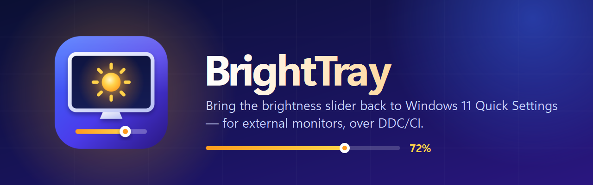

<div align="center">



<br>
<br>

**English** · [简体中文](README.zh-CN.md)

<br>


<br>
<br>


</div>

<br>

Desktop PCs have no brightness slider in Quick Settings. BrightTray brings back the native one and wires it to your external monitor over DDC/CI.

## Features

- **Native** — the real Windows slider, not an overlay or a tray popup
- **Two-way** — changes made on the monitor's OSD flow back to the slider
- **Keys work too** — the brightness keys on your keyboard move the monitor, once a display is applied
- **Safe** — no hard-coded offsets; every patch is verified first, or skipped
- **Light** — no admin rights, no system files touched, lives in the tray

## Quick start

Requires Windows 11 24H2 or later and a monitor with DDC/CI enabled. It also needs the
[Microsoft Edge WebView2 Evergreen Runtime](https://go.microsoft.com/fwlink/p/?LinkId=2124703),
which ships with Windows 11; if it is missing, BrightTray says so and exits instead of failing
silently.

```powershell
git clone https://github.com/cestbon0309/BrightTray.git
cd BrightTray
cargo build --release
```

Run `target\release\BrightTray.exe`, pick a display, click **Apply**, then press <kbd>Win</kbd> + <kbd>A</kbd>.

`BrightTray.exe` is a single self-contained file — copy it anywhere.

## How it works


A hook inside `ShellHost.exe` makes the hidden brightness tile applicable and forwards its value over a named pipe; the helper writes it to the monitor. The full reverse-engineering notes are in [docs/quick-settings-hook-research.md](docs/quick-settings-hook-research.md) (Chinese).

## CLI

<details>
<summary><code>brighttray-helper &lt;command&gt;</code></summary>

<br>

| Command | Description |
|---|---|
| `list` | List monitors and their DDC/CI brightness |
| `set <index> <0-100>` | Set one monitor's brightness |
| `serve` | Run the pipe server and inject the hook, re-injecting when ShellHost restarts |
| `inject [--early --force-restart] [dll]` | Inject the hook manually |
| `probe` | Read-only compatibility check |
| `watch` | Print Windows brightness slider changes |

`serve` controls every DDC/CI monitor and cannot run alongside the desktop app. Unlike the app, the helper needs `brighttray_hook.dll` next to it.

</details>

<details>
<summary>Pipe protocol — <code>\\.\pipe\BrightTray</code></summary>

<br>

One command per line, local connections only. Only the user who started BrightTray can connect to the pipe, and a low-integrity process cannot write to it.

| Command | Reply |
|---|---|
| `list` | `index\tcurrent\tmax\tname` per monitor, then an empty line |
| `get <index>` | `current max`, or `err` |
| `set <index> <0-100>` | none |
| `getall` | brightness percent of the first DDC/CI monitor, or `err` |
| `setall <0-100>` | none |

</details>

## FAQ

<details>
<summary>The slider doesn't appear</summary>

<br>

Run `brighttray-helper list` to confirm the monitor reports a brightness; if it doesn't, enable DDC/CI in the monitor's OSD. Then check `%TEMP%\brighttray-hook.log` for `IQuickAction hook installed`. The log is capped at 1 MiB; once it fills up, the previous generation sits next to it as `%TEMP%\brighttray-hook.log.1`, so check that file too.

BrightTray never restarts Windows' shell on its own. If the slider still does not show up, the shell may have cached "no brightness" before the hook was in place — pick **Restart ShellHost** in the tray menu to give it a fresh start. From the command line, `brighttray-helper inject --early --force-restart` does the same thing.

</details>

<details>
<summary>BrightTray says WebView2 is missing, but it is installed</summary>

<br>

BrightTray reads the EdgeUpdate registration Microsoft documents for the runtime, so a false "missing" should not happen. The two cases it can get wrong are a **fixed-version** runtime (a per-application `Microsoft.WebView2.FixedVersionRuntime.*` folder, which writes no registration at all) and a locked-down or redirected registry. `BRIGHTTRAY_FAKE_WEBVIEW2=1` skips the check and lets WebView2 decide for itself; `BRIGHTTRAY_FAKE_WEBVIEW2=0` forces the message, which is how it is tested.

</details>

<details>
<summary>The brightness keys on my keyboard show the Windows OSD but change nothing</summary>

<br>

On a desktop with only external monitors Windows has no display it can dim itself, so the brightness keys stop at the on-screen display: they never reach Quick Settings and never issue a DDC/CI command.

BrightTray listens for those keys directly (raw input, no hook, no elevation) and moves the applied display by 10 points per press, once **Apply** has been used. The Windows OSD still appears and keeps its own number, which can differ from the monitor — BrightTray changes the monitor, not Windows' idea of it.

If the keys do nothing, check that a display shows as applied in the window, and that another BrightTray (for example `brighttray-helper serve`) is not holding the pipe.

</details>

<details>
<summary>On my laptop, changing the brightness also changes the external monitor</summary>

<br>

A laptop has a display Windows dims itself, so the system keeps its own brightness paths alive: **Settings > Display**, the brightness keys before BrightTray claims them, and whatever else publishes the `GUID_VIDEO_CURRENT_MONITOR_BRIGHTNESS` power setting. BrightTray follows that setting and forwards the moves to the monitors, so a change you meant for the laptop panel also moves the external display. The writes are paced (at most one per 300 ms, not one per slider step), but each of them is a DDC/CI write, which is an EEPROM write on the monitor. With **Apply** the GUI's target narrows to the display you applied — still not the panel you were dimming.

Set `BRIGHTTRAY_NO_MIRROR=1` in the environment BrightTray starts from (`true`, `yes` and `on` work too, in any case) and the helper stops following the Windows brightness setting: no callback, no writes. The rest keeps working — the Quick Settings slider BrightTray installs and the brightness keys are separate paths. Remove the variable, or set it to `0`, to get the mirroring back. The default is unchanged: unset, it mirrors as it always has.

</details>

<details>
<summary>My antivirus flags it</summary>

<br>

BrightTray loads a DLL into `ShellHost.exe` with `CreateRemoteThread`, which some security software treats as suspicious. The source is all here to audit and build yourself.

</details>

<details>
<summary>How do I uninstall it?</summary>

<br>

Turn off **Start with Windows**, choose **Exit** from the tray menu, then sign out or restart ShellHost. Then delete `%APPDATA%\BrightTray`, which holds the settings and the extracted hook.

</details>

## Disclaimer

BrightTray patches undocumented internals of the Windows shell. A system update may break it. Use at your own risk.

## Friends

[LINUX DO](https://linux.do/)

<br>

<div align="center">

</div>
