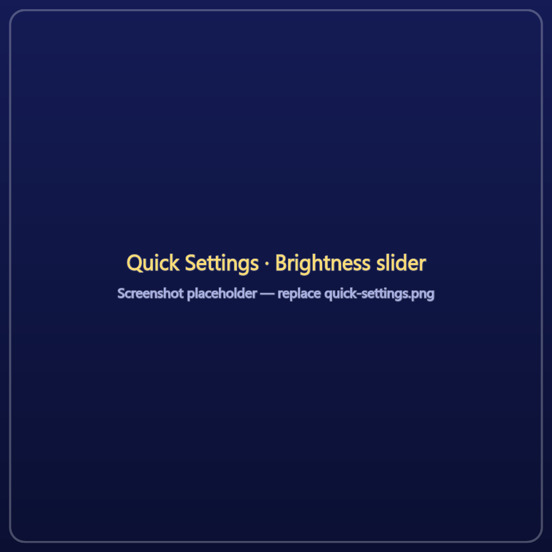
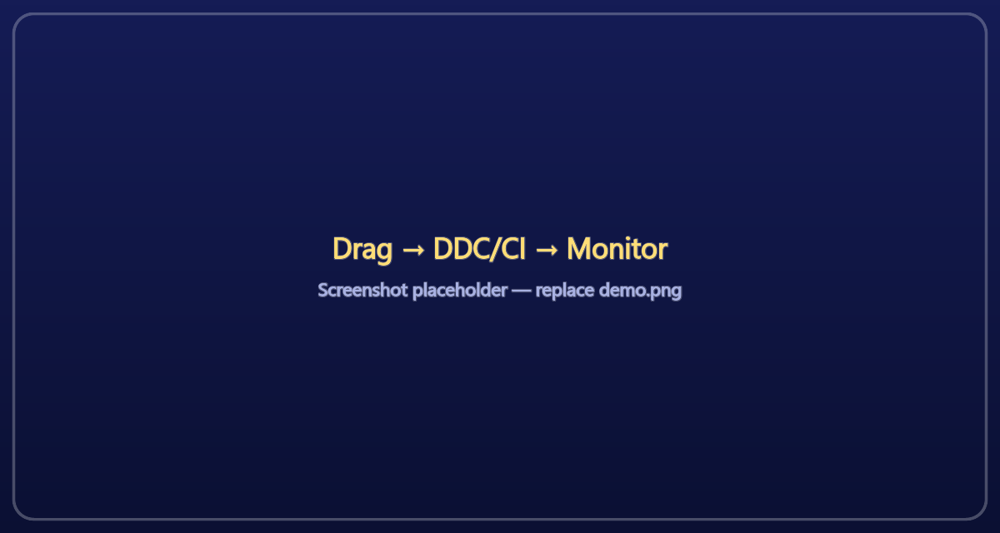
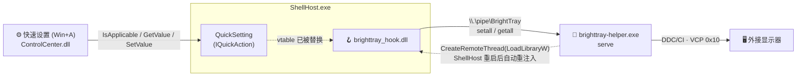
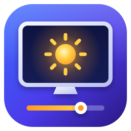

<div align="center">


<h3>让台式机的 Windows 11 快速设置（Win + A）重新拥有亮度条，并通过 DDC/CI 直接调节外接显示器。</h3>

<p>
  
  
  
  
  
</p>

<p>
  <a href="#-特性">特性</a> ·
  <a href="#-快速开始">快速开始</a> ·
  <a href="#-工作原理">工作原理</a> ·
  <a href="#-命令行">命令行</a> ·
  <a href="#-管道协议">管道协议</a> ·
  <a href="#-常见问题">常见问题</a>
</p>

</div>

---

<div align="center">
  
  <br>
  <sub>注入后，快速设置里出现原生亮度条；拖动即可调节外接显示器的背光。</sub>
</div>

## 💡 为什么需要 BrightTray

笔记本上习以为常的亮度条，**在只接了外接显示器的台式机上是不存在的**。Windows 判断"没有能调亮度的屏幕"，于是快速设置直接把亮度磁贴藏了起来。

可实际上，绝大多数显示器都支持 **DDC/CI**，系统完全能通过显卡线路调节它们的背光，只是没有把这条路径接到 UI 上。

BrightTray 把这两头接了起来：

- 不是另做一个悬浮窗或托盘滑块，而是**让 Windows 自己的亮度条出现**，外观、动画、键盘操作都和原生一致；
- 拖动亮度条时，数值经命名管道交给后台 helper，由它通过 DDC/CI 写入显示器；
- 在显示器 OSD 上手动改了亮度，滑块也会自动跟着刷新。

## ✨ 特性

| | |
|---|---|
| 🎚️ **原生体验** | 直接复用快速设置里的系统亮度条，没有额外窗口，也没有第三方 UI |
| 🖥️ **DDC/CI 直连** | 通过 `dxva2` 物理显示器 API 读写 VCP `0x10`（亮度），按显示器自身量程换算百分比 |
| 🔁 **双向同步** | 外部改了亮度（OSD、其他工具）会回写到滑块；拖动后 1.2 秒内忽略回读，滑块不会"往回弹" |
| ⚡ **合并写入** | DDC/CI 单条命令约 50 ms，连续拖动产生的写入只保留最新值，不排长队 |
| 🛡️ **零硬编码地址** | 不依赖任何 RVA 或 PDB：通过导出函数拿到对象，再用 `get_Id` / `FriendlyName` 校验身份后才打补丁 |
| 🧯 **失败即放弃** | vtable 不在模块范围内、ID 不匹配、导出缺失，都会直接放弃安装，不会弄崩 ShellHost |
| ♻️ **自动续命** | `serve` 模式持续监视 ShellHost，进程重启后自动重新注入 |
| 🔓 **无需管理员** | ShellHost 以当前用户、中完整性级别运行，普通权限即可注入 |
| 🔌 **开放接口** | 提供 `\\.\pipe\BrightTray` 文本协议，脚本或其他工具都能调用 |
| 🔍 **只读诊断** | `probe` 子命令只查询、不打补丁，可在注入前先确认系统是否兼容 |

## 🚀 快速开始

### 环境要求

- Windows 11 24H2 或更新版本（快速设置由 `ShellHost.exe` 承载）
- 支持 **DDC/CI** 的外接显示器，并在显示器 OSD 中开启 DDC/CI
- [Rust](https://rustup.rs/) 工具链（MSVC，x64）

### 构建

```powershell
git clone <repo-url> BrightTray
cd BrightTray
cargo build --release
```

产物位于 `target\release\`：

```text
brighttray-helper.exe   # 常驻进程：DDC/CI、命名管道、注入器
brighttray_hook.dll     # 注入 ShellHost.exe 的 hook
```

> [!IMPORTANT]
> 两个文件必须放在**同一目录**，helper 默认从自身旁边加载 `brighttray_hook.dll`。

### 运行

```powershell
# 1) 先确认显示器支持 DDC/CI
target\release\brighttray-helper.exe list

# 2) 启动常驻服务：管道服务 + 监视 ShellHost，首次以及重启后自动注入
target\release\brighttray-helper.exe serve
```

然后按 <kbd>Win</kbd> + <kbd>A</kbd>，亮度条就会出现在音量滑块旁边。

<div align="center">
  
</div>

## 🧠 工作原理



1. **定位亮度磁贴**：亮度磁贴 `Microsoft.QuickAction.Brightness` 在 `QuickActionsDataModel.dll` 中是一个 `QuickSetting` 对象。hook 通过导出函数 `GetQuickActionsProvider` → `GetQuickActionByFriendlyName` 拿到实例，**不依赖任何偏移**。
2. **校验后打补丁**：确认 vtable 和各个槽位都位于模块映像内、`get_Id` 返回 `SystemSettings_Display_Brightness` 之后，替换 `IsApplicable`、`IsEnabled`、`GetValue`、`SetValue` 以及属性变更事件等槽位。
3. **只影响亮度实例**：该 vtable 由 Wi-Fi、蓝牙等所有磁贴共用，每个替换函数都会先用 `get_Id` 判断实例，非亮度磁贴原样转发给系统实现。
4. **转发到 helper**：`SetValue("Value")` 把百分比经命名管道交给 helper；hook 本身从不直接操作显示器句柄。
5. **回写 UI**：后台 watcher 定期读取 DDC 亮度，发现变化就调用已登记的 UI 事件处理器刷新滑块。

完整的逆向分析、vtable 槽位表和实测记录见 **[docs/quick-settings-hook-research.md](docs/quick-settings-hook-research.md)**。

## ⌨️ 命令行

```text
brighttray-helper <command> [args]
```

| 命令 | 说明 |
|---|---|
| `list` | 列出所有物理显示器及其 DDC/CI 亮度（不带参数时的默认命令） |
| `set <index> <0-100>` | 设置指定显示器的亮度百分比 |
| `serve` | 常驻：启动管道服务，并在 ShellHost 启动或重启后自动注入 hook |
| `inject [dll]` | 手动把 hook 注入当前所有 ShellHost 进程 |
| `inject --early [dll]` | 以挂起方式重启 ShellHost，抢在它初始化前完成注入（备用方案） |
| `probe` | 只读诊断：查询 `DisplayBrightness` 与 `QuickAction` 对象，不打补丁 |
| `watch` | 打印 Windows 亮度滑块的变化（基于电源通知，用于调试） |

| 环境变量 | 作用 |
|---|---|
| `BRIGHTTRAY_NO_HOOK=1` | `serve` 只启动管道服务，不注入 hook |

## 🔌 管道协议

`\\.\pipe\BrightTray`：支持多个客户端同时连接，每行一条命令，仅接受本机连接。

| 命令 | 回复 |
|---|---|
| `list` | 每台显示器一行 `index\tcurrent\tmax\tdescription`，以空行结束 |
| `get <index>` | `current max`，失败时返回 `err` |
| `set <index> <0-100>` | 无回复；连续设置会被合并 |
| `getall` | 第一台支持 DDC/CI 的显示器的亮度百分比，失败时返回 `err` |
| `setall <0-100>` | 无回复；应用到所有支持 DDC/CI 的显示器 |

PowerShell 示例：

```powershell
$pipe = New-Object System.IO.Pipes.NamedPipeClientStream('.', 'BrightTray', 'InOut')
$pipe.Connect(1000)
$w = New-Object System.IO.StreamWriter($pipe); $w.AutoFlush = $true
$r = New-Object System.IO.StreamReader($pipe)
$w.WriteLine('getall'); $r.ReadLine()   # -> 72
$w.WriteLine('setall 40')
$pipe.Dispose()
```

## 🛡️ 安全与稳定性

BrightTray 运行在系统 Shell 进程内部，因此把"不出事"放在第一位：

- **DllMain 极简**：只启动工作线程，所有解析和打补丁都在 loader lock 释放之后进行。
- **多重校验**：模块范围、vtable 槽位、`get_Id`、`FriendlyName` 任一不符就放弃安装。
- **异常隔离**：每个替换函数都包在 `catch_unwind` 中，Rust panic 不会越过 COM 边界。
- **引用安全**：登记的 UI handler 持有 AddRef，回调前再次 AddRef，避免并发移除导致悬垂指针。
- **模块固定**：hook DLL 用 `GET_MODULE_HANDLE_EX_FLAG_PIN` 固定自身，vtable 仍指向它时不会被卸载。
- **职责分离**：hook 只做 UI 绑定，所有 DDC/CI 操作都在 helper 进程中完成。

## ✅ 已验证环境

| 项目 | 版本 / 型号 |
|---|---|
| 系统 | Windows 11 Insider，build 26300 |
| 显示器 | Lenovo Y27q-30（DDC/CI） |
| 相关模块 | `QuickActionsDataModel.dll`、`SettingsHandlers_PCDisplay.dll`（随系统更新变化，安装前会自动校验） |

欢迎提交 Issue 补充你的系统版本与显示器型号。

## ❓ 常见问题

<details>
<summary><b>亮度条没有出现？</b></summary>

1. 先运行 `brighttray-helper list`，确认显示器能读到亮度；读不到时请在显示器 OSD 里开启 DDC/CI。
2. 查看 hook 日志 `%TEMP%\brighttray-hook.log`，应能看到 `IQuickAction hook installed`。
3. 如果日志显示校验失败，说明系统更新改变了接口布局，请附上日志提交 Issue。
4. 也可以试试 `inject --early`，它会重启 ShellHost 并在初始化前完成注入。

</details>

<details>
<summary><b>杀毒软件报警？</b></summary>

BrightTray 通过 `CreateRemoteThread(LoadLibraryW)` 把 DLL 注入 `ShellHost.exe`，部分安全软件会把这种远程线程注入视为可疑行为。代码完全开源，可以自行审阅并构建。

</details>

<details>
<summary><b>多台显示器怎么处理？</b></summary>

快速设置的亮度条会通过 `setall` 同步调节**所有**支持 DDC/CI 的显示器；读取时以第一台支持 DDC/CI 的显示器为准。需要单独调节时，可以用 `set <index> <p>` 或管道协议。

</details>

<details>
<summary><b>如何卸载？</b></summary>

结束 `brighttray-helper.exe`，然后重启 ShellHost（或注销 / 重启系统）即可。BrightTray 不修改注册表，也不改动任何系统文件。

</details>

<details>
<summary><b>Windows 以后会原生支持吗？</b></summary>

有可能。`SettingsHandlers_PCDisplay.dll` 中已经存在未开放的 `Feature_ExternalBrightness` 特性开关，详见 [研究文档 §4](docs/quick-settings-hook-research.md#4-顺带发现windows-自带的外接屏-ddcci-亮度未开放)。如果系统正式放出该功能，BrightTray 就可以退役了。

</details>

## 🗺️ Roadmap

- [x] DDC/CI 读写与命名管道服务
- [x] 快速设置亮度条注入（`IQuickAction` hook）
- [x] 外部亮度变化回写 UI
- [x] ShellHost 重启后自动重注入
- [ ] 托盘图标与右键菜单
- [ ] 开机自启（无控制台窗口）
- [ ] 多显示器独立滑块
- [ ] 安装包与签名发布

## 📁 项目结构

```text
BrightTray/
├── helper/                 # brighttray-helper.exe
│   └── src/
│       ├── main.rs         # 命令行入口
│       ├── ddc.rs          # DDC/CI 物理显示器访问
│       ├── server.rs       # 命名管道服务与写入合并
│       ├── inject.rs       # 远程线程注入、ShellHost 监视
│       ├── slider.rs       # 订阅系统亮度滑块（电源通知）
│       └── probe.rs        # 只读兼容性诊断
├── hook/                   # brighttray_hook.dll
│   └── src/
│       ├── lib.rs          # ISettingItem / IQuickAction vtable hook
│       └── pipe.rs         # helper 管道客户端
├── assets/                 # 图标与横幅
└── docs/                   # 逆向研究与截图
```

## ⚠️ 免责声明

BrightTray 会向系统 Shell 进程注入代码并修改其内存中的虚函数表，这依赖未公开的系统内部接口。尽管每一步都做了校验与降级，系统更新仍可能导致它失效。使用风险由使用者自行承担。

## 📄 License

暂未指定许可证。<!-- TODO: 添加 LICENSE 文件（例如 MIT），并在此处更新 -->

<div align="center">
<br>

<br>
<sub>Made with ☀️ and Rust</sub>
</div>
