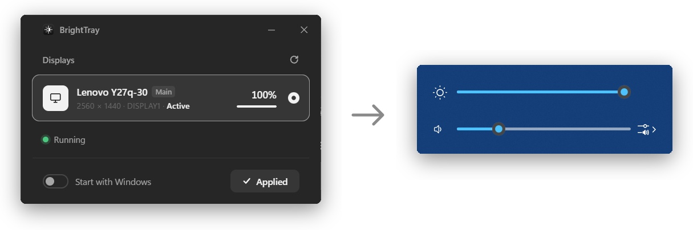
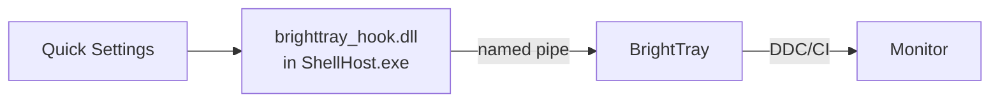

<div align="center">


<br>
<br>

**English** · [简体中文](README.zh-CN.md)

<br>


<br>
<br>



</div>

<br>

Desktop PCs have no brightness slider in Quick Settings. BrightTray brings back the native one and wires it to your external monitor over DDC/CI.

## Features

- **Native** — the real Windows slider, not an overlay or a tray popup
- **Two-way** — changes made on the monitor's OSD flow back to the slider
- **Safe** — no hard-coded offsets; every patch is verified first, or skipped
- **Light** — no admin rights, no system files touched, lives in the tray

## Quick start

Requires Windows 11 24H2 or later and a monitor with DDC/CI enabled.

```powershell
git clone https://github.com/cestbon0309/BrightTray.git
cd BrightTray
cargo build --release
```

Run `target\release\BrightTray.exe`, pick a display, click **Apply**, then press <kbd>Win</kbd> + <kbd>A</kbd>.

`BrightTray.exe` is a single self-contained file — copy it anywhere.

## How it works



A hook inside `ShellHost.exe` makes the hidden brightness tile applicable and forwards its value over a named pipe; the helper writes it to the monitor. The full reverse-engineering notes are in [docs/quick-settings-hook-research.md](docs/quick-settings-hook-research.md) (Chinese).

## CLI

<details>
<summary><code>brighttray-helper &lt;command&gt;</code></summary>

<br>

| Command | Description |
|---|---|
| `list` | List monitors and their DDC/CI brightness |
| `set <index> <0-100>` | Set one monitor's brightness |
| `serve` | Run the pipe server and inject the hook, re-injecting when ShellHost restarts |
| `inject [--early] [dll]` | Inject the hook manually |
| `probe` | Read-only compatibility check |
| `watch` | Print Windows brightness slider changes |

`serve` controls every DDC/CI monitor and cannot run alongside the desktop app. Unlike the app, the helper needs `brighttray_hook.dll` next to it.

</details>

<details>
<summary>Pipe protocol — <code>\\.\pipe\BrightTray</code></summary>

<br>

One command per line, local connections only.

| Command | Reply |
|---|---|
| `list` | `index\tcurrent\tmax\tdescription` per monitor, then an empty line |
| `get <index>` | `current max`, or `err` |
| `set <index> <0-100>` | none |
| `getall` | brightness percent of the first DDC/CI monitor, or `err` |
| `setall <0-100>` | none |

</details>

## FAQ

<details>
<summary>The slider doesn't appear</summary>

<br>

Run `brighttray-helper list` to confirm the monitor reports a brightness; if it doesn't, enable DDC/CI in the monitor's OSD. Then check `%TEMP%\brighttray-hook.log` for `IQuickAction hook installed`.

</details>

<details>
<summary>My antivirus flags it</summary>

<br>

BrightTray loads a DLL into `ShellHost.exe` with `CreateRemoteThread`, which some security software treats as suspicious. The source is all here to audit and build yourself.

</details>

<details>
<summary>How do I uninstall it?</summary>

<br>

Turn off **Start with Windows**, choose **Exit** from the tray menu, then sign out or restart ShellHost. Then delete `%APPDATA%\BrightTray`, which holds the settings and the extracted hook.

</details>

## Disclaimer

BrightTray patches undocumented internals of the Windows shell. A system update may break it. Use at your own risk.

<br>

<div align="center">

</div>
