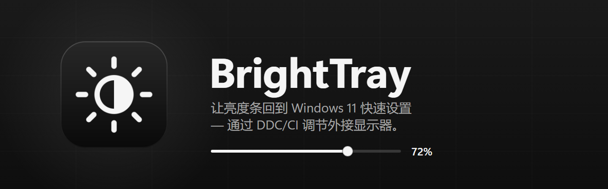
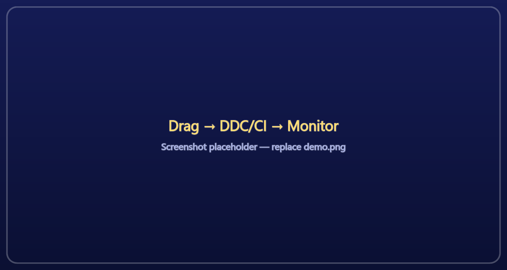
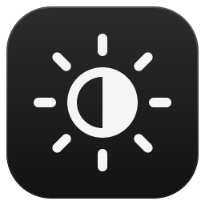

<div align="center">



<br>
<br>

[English](README.md) · **简体中文**

<br>


<br>
<br>



</div>

<br>

台式机的快速设置里没有亮度条。BrightTray 让系统原生的亮度条重新出现，并通过 DDC/CI 调节外接显示器。

## 特性

- **原生** — 就是 Windows 自己的亮度条，不是悬浮窗或托盘弹窗
- **双向同步** — 在显示器 OSD 上改了亮度，滑块会跟着变
- **键盘亮度键可用** — 应用显示器之后，键盘上的亮度键直接调节显示器
- **安全** — 不写死任何偏移；每次打补丁前都先校验，不符就放弃
- **轻量** — 无需管理员权限，不改动系统文件，常驻托盘

## 快速开始

需要 Windows 11 24H2 或更新版本，以及开启了 DDC/CI 的显示器。还需要
[Microsoft Edge WebView2 Evergreen Runtime](https://go.microsoft.com/fwlink/p/?LinkId=2124703)
（Windows 11 默认自带）；如果缺少它，BrightTray 会提示原因并退出，而不是静默失败。

```powershell
git clone https://github.com/cestbon0309/BrightTray.git
cd BrightTray
cargo build --release
```

运行 `target\release\BrightTray.exe`，选中显示器，点击 **应用**，然后按 <kbd>Win</kbd> + <kbd>A</kbd>。

`BrightTray.exe` 是独立的单文件，可以拷贝到任意位置使用。

## 工作原理


注入 `ShellHost.exe` 的 hook 让被隐藏的亮度磁贴生效，并把数值经命名管道转发出去，再由 helper 写入显示器。完整的逆向分析见 [docs/quick-settings-hook-research.md](docs/quick-settings-hook-research.md)。

窗口一次只驱动**一台**显示器：快速设置里的亮度条调的是你点过“应用”的那台，这个选择记录在 `%APPDATA%\BrightTray\config.ini` 里。想按显示器逐一操作，请改用命令行：`brighttray-helper set <index> <0-100>` 按索引设置某一台，`brighttray-helper serve` 同时驱动全部支持 DDC/CI 的显示器（它的管道还接受按索引的 `get` / `set`，以及 `getall` / `setall`）。

两者不能同时运行：它们都占用管道 `\\.\pipe\BrightTray`，同一时间只能有一个进程在服务。被命令行占着时，窗口会提示“另一个 BrightTray（例如 `brighttray-helper serve`）正在运行，请先关闭它。” —— 关掉另一个进程后再点“应用”。

## 命令行

<details>
<summary><code>brighttray-helper &lt;command&gt;</code></summary>

<br>

| 命令 | 说明 |
|---|---|
| `list` | 列出显示器及其 DDC/CI 亮度 |
| `set <index> <0-100>` | 设置指定显示器的亮度 |
| `serve` | 启动管道服务并注入 hook，ShellHost 重启后自动重新注入 |
| `inject [--early --force-restart] [dll]` | 手动注入 hook |
| `probe` | 只读的兼容性检查 |
| `watch` | 打印 Windows 亮度滑块的变化 |

`serve` 会控制所有支持 DDC/CI 的显示器，不能和桌面应用同时运行。与桌面应用不同，helper 需要 `brighttray_hook.dll` 放在它旁边。

</details>

<details>
<summary>管道协议 — <code>\\.\pipe\BrightTray</code></summary>

<br>

每行一条命令，仅接受本机连接。只有启动 BrightTray 的用户可以连接管道，低完整性进程无法写入。

| 命令 | 回复 |
|---|---|
| `list` | 每台显示器一行 `index\tcurrent\tmax\tdescription`，以空行结束 |
| `get <index>` | `current max`，失败时返回 `err` |
| `set <index> <0-100>` | 无 |
| `getall` | 第一台支持 DDC/CI 的显示器的亮度百分比，失败时返回 `err` |
| `setall <0-100>` | 无 |

</details>

## 常见问题

<details>
<summary>亮度条没有出现</summary>

<br>

先运行 `brighttray-helper list`，确认显示器能读到亮度；读不到时请在显示器 OSD 里开启 DDC/CI。然后查看 `%TEMP%\brighttray-hook.log`，其中应有 `IQuickAction hook installed`。日志上限为 1 MiB，写满后上一份日志会保存在 `%TEMP%\brighttray-hook.log.1`，也请一并查看。

BrightTray 不会自行重启 Windows 的 shell。如果亮度条仍然不出现，可能是 shell 在 hook 就位之前就把"没有亮度"缓存下来了 —— 在托盘菜单里选 **重启 ShellHost**，让它重新开始。命令行下用 `brighttray-helper inject --early --force-restart` 效果相同。

</details>

<details>
<summary>BrightTray 提示缺少 WebView2，但本机已经安装</summary>

<br>

BrightTray 读取的是微软文档所述的 EdgeUpdate 注册信息，正常情况下不会误报。可能出错的只有两种情况：**固定版本**运行时（按应用放置的 `Microsoft.WebView2.FixedVersionRuntime.*` 目录，它不写任何注册信息），以及被策略锁定或重定向的注册表。设置 `BRIGHTTRAY_FAKE_WEBVIEW2=1` 可以跳过检查、交给 WebView2 自己判断；`BRIGHTTRAY_FAKE_WEBVIEW2=0` 则强制显示这条提示，测试用的就是它。

</details>

<details>
<summary>按键盘亮度键会弹出 Windows 的亮度提示，但亮度没变</summary>

<br>

只有外接显示器的台式机上，Windows 找不到自己能调暗的屏幕，亮度键的处理就停在屏幕提示这一步：既不会走到快速设置，也不会发出任何 DDC/CI 命令。

BrightTray 自己监听这些按键（Raw Input，不用 hook，也不需要管理员权限）。用过 **应用** 之后，每按一次按键，目标显示器亮度变化 10 点。Windows 的屏幕提示仍会出现，并显示它自己的数值，可能和显示器实际亮度不一致 —— BrightTray 改的是显示器，不是 Windows 记的那个数。

按键没反应时，先确认窗口里有显示器处于已应用状态，并确认没有另一个 BrightTray（例如 `brighttray-helper serve`）占着管道。

</details>

<details>
<summary>笔记本上调亮度，外接显示器也跟着变</summary>

<br>

笔记本有一块 Windows 自己能调暗的屏幕，所以系统保留了它自己的亮度路径：**设置 > 显示**、BrightTray 接管之前的亮度键，以及其他会发布 `GUID_VIDEO_CURRENT_MONITOR_BRIGHTNESS` 电源设置的地方。BrightTray 跟随这个设置，把这些变化转发给显示器，所以本来只想改内屏的亮度，外接显示器也会跟着动。写入是节流的（最多每 300 毫秒一次，而不是每一步一次），但每一次都是 DDC/CI 写入，对显示器来说就是一次 EEPROM 写入。用过 **应用** 之后，图形界面的目标会缩小到选中的那台显示器 —— 仍然不是你在调的那块内屏。

在 BrightTray 启动时的环境里设置 `BRIGHTTRAY_NO_MIRROR=1`（`true`、`yes`、`on` 也可以，大小写不限），helper 就不再跟随 Windows 的亮度设置：没有回调，也没有写入。其余功能照旧 —— 快速设置里 BrightTray 安装的亮度条和亮度键走的是另外的路径。删掉这个变量，或把它设为 `0`，就恢复跟随。默认行为没有变化：不设置时，和以前一样跟随。

</details>

<details>
<summary>杀毒软件报警</summary>

<br>

BrightTray 通过 `CreateRemoteThread` 把 DLL 加载进 `ShellHost.exe`，部分安全软件会把这种行为视为可疑。源码都在这里，可以自行审阅并构建。

</details>

<details>
<summary>如何卸载？</summary>

<br>

在托盘菜单里选 **卸载 BrightTray…** 并确认。它会删除 **开机自启动** 项、`%APPDATA%\BrightTray\config.ini` 和释放出的 hook DLL（包括升级时留下的 `brighttray_hook.old-*.dll` 副本），然后退出，剩下的 `BrightTray.exe` 由你手动删除。

如果 hook DLL 删不掉，通常是因为 `ShellHost` 还加载着它，而 Windows 不允许删除正在使用的文件；提示框会写明是哪个文件。注销或重启 Windows 卸载 hook，然后删除提示框给出的文件夹（也就是 `BrightTray.exe` 所在的文件夹）。

已经删掉 `BrightTray.exe` 了？下面这几行 PowerShell 做的是同一件事，不需要任何 BrightTray 文件 —— 把最后一行换成可执行文件原来的位置：

```powershell
Remove-ItemProperty -Path 'HKCU:\Software\Microsoft\Windows\CurrentVersion\Run' -Name BrightTray -ErrorAction SilentlyContinue
Remove-Item -Recurse -Force "$env:APPDATA\BrightTray"
Remove-Item -Force 'C:\path\to\BrightTray.exe'
```

如果 `Remove-Item` 提示文件正在使用，说明 hook 仍被加载：注销或重启 Windows 后再执行同一行。`%TEMP%\brighttray-hook.log` 只是诊断日志，留着或手动删掉都可以。

</details>

## 免责声明

BrightTray 会修改 Windows Shell 未公开的内部接口，系统更新可能导致它失效。使用风险自负。

## 友情链接

[LINUX DO](https://linux.do/)

<br>

<div align="center">

</div>
